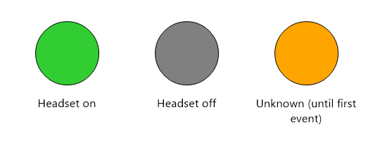
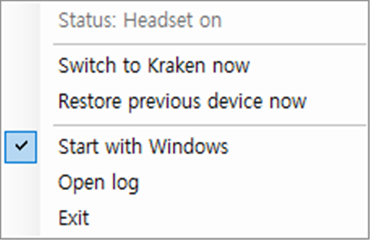

# Razer Kraken V4 Auto Switch

**한국어 | English** (병기 / bilingual) · [⬇ Download / 다운로드](https://github.com/TresureStrong-Gold/razer-kraken-v4-auto-switch/releases/latest)

> **Razer Kraken V4 (wireless / USB dongle) auto audio output switch for Windows.**
> Turn the headset on → Windows output switches to the Kraken. Turn it off → it switches back to your speakers. The dongle can stay plugged in.
>
> **Razer Kraken V4 (무선 동글) 헤드폰 전원 on/off에 맞춰 Windows 출력 장치를 자동 전환합니다.**
> 헤드폰을 켜면 Kraken으로, 끄면 다시 스피커로. 동글은 계속 꽂아 둬도 됩니다.



## 이런 분께 / Who is this for

- 동글을 상시 꽂아 두고 헤드폰만 켜고 끄는데, 끌 때마다 **소리가 안 나와서** 출력 장치를 수동으로 바꾸시는 분
  You keep the dongle plugged in, and every time you power the headset off the sound goes nowhere until you switch the output device by hand.
- "Razer Kraken V4 auto switch audio output", "dongle always connected", "headset power off no sound" 로 검색해 오신 분
  You searched for *Razer Kraken V4 auto switch audio output*, *dongle always connected*, or *headset off no sound*.

Windows 는 동글의 오디오 장치를 헤드폰이 꺼져도 계속 "연결됨"으로 보기 때문에 기본 기능으로는 자동 전환이 되지 않습니다.
Windows keeps the dongle's audio devices "connected" even when the headset is off, so there is no built-in way to auto-switch.

| 헤드폰 / Headset | 동작 / Action |
|---|---|
| ON  | 재생 장치 → `Razer Kraken V4 - Game`, 통신 장치 → `Razer Kraken V4 - Chat` (직전 기본 장치는 저장)<br>Playback → `Razer Kraken V4 - Game`, communications → `Razer Kraken V4 - Chat` (previous defaults are remembered) |
| OFF | 저장해 둔 직전 장치(스피커, 모니터 등)로 복원<br>Restores the previously remembered devices (speakers, monitor, etc.) |

## 설치 / Install

### 방법 1: 내려받아 실행 / Option 1: Download
1. [Releases](https://github.com/TresureStrong-Gold/razer-kraken-v4-auto-switch/releases/latest) 에서 `KrakenAutoSwitch.exe` 다운로드
   Download `KrakenAutoSwitch.exe` from [Releases](https://github.com/TresureStrong-Gold/razer-kraken-v4-auto-switch/releases/latest).
2. 원하는 폴더에 넣고 실행 (설정·로그 파일이 같은 폴더에 생성됩니다. `Downloads`보다 `%LOCALAPPDATA%\KrakenAutoSwitch` 같은 고정 폴더를 권장)
   Put it in a permanent folder (settings and log files are created next to it) and run it.
3. 트레이 아이콘 우클릭 → "Start with Windows"(한국어 Windows 에서는 "Windows 시작 시 자동 실행") 체크
   Right-click the tray icon and enable "Start with Windows".

> ⚠️ **SmartScreen 경고 / SmartScreen warning**
> 코드 서명이 없는 개인 프로젝트라 "Windows의 PC 보호" 경고가 뜰 수 있습니다. "추가 정보 → 실행"을 누르세요. 못 미더우면 아래 방법 2로 소스에서 직접 빌드할 수 있고, Releases 의 SHA-256 으로 파일을 검증할 수 있습니다.
> This is an unsigned hobby project, so Windows may show a "Windows protected your PC" prompt. Click "More info → Run anyway". If you'd rather not trust a binary, build it yourself (Option 2) or verify the SHA-256 listed on the release.

### 방법 2: 직접 빌드 / Option 2: Build from source
`build.bat` 실행 (Windows 기본 .NET Framework 컴파일러만 사용, 별도 설치 불필요).
Run `build.bat` (uses only the .NET Framework compiler that ships with Windows; nothing to install).

## 사용법 / Usage

English UI (default) / 한국어 UI (Windows 표시 언어가 한국어면 자동):

 

- 아이콘 색: 초록=켜짐, 회색=꺼짐, 주황=아직 모름(첫 on/off 이벤트 전)
  Icon colors: green = on, gray = off, orange = not known yet (until the first on/off event).
- 메뉴에서 수동 전환, 자동 실행 토글, 로그 보기를 할 수 있습니다.
  The menu offers manual switching, a start-with-Windows toggle and the log.

첫 실행 시 `KrakenAutoSwitch.ini`가 생성됩니다. / A `KrakenAutoSwitch.ini` is created on first run.

```ini
; Device names are substring matches / 장치 이름은 '포함' 일치
game=Razer Kraken V4 - Game
chat=Razer Kraken V4 - Chat
; Device to restore if nothing was remembered / 저장된 장치가 없을 때 복원할 장치
fallback=
; UI language: auto (follow Windows) | en | ko
language=auto
```

Windows 가 한국어가 아니어도 장치 이름이 `Razer Kraken V4 - Game` 을 포함하면 동작합니다.
Works on any Windows language as long as the device name contains `Razer Kraken V4 - Game`.

## 원리 / How it works

헤드폰이 꺼져도 동글의 오디오 장치는 계속 활성 상태라 장치 목록으로는 on/off를 알 수 없습니다. 대신 동글(`VID 1532 / PID 056C`)의 벤더 HID 인터페이스(Usage Page `0xFF14`)로 들어오는 이벤트를 읽습니다.
Instead, the app reads events from the dongle's vendor HID interface (`VID 1532 / PID 056C`, Usage Page `0xFF14`):

```
02 0A 60 .. .. .. 05 00 80 80 20 02 01 <state>      state: 01 = on, 00 = off
```

오디오 전환은 Core Audio + `IPolicyConfigVista`(비공개 COM 인터페이스, SoundSwitch 등 다수 도구가 사용)로 합니다.
Synapse가 실행 중이어도 HID를 공유 모드로 읽기 때문에 충돌하지 않습니다.
Switching uses Core Audio plus `IPolicyConfigVista` (an undocumented COM interface also used by tools such as SoundSwitch). HID is opened in shared mode, so it coexists with Razer Synapse.

## 한계 / Limitations

- 프로그램 시작 시점의 헤드폰 상태는 알 수 없고, 다음 on/off 이벤트부터 맞춰집니다 (트레이 메뉴에서 수동 전환 가능).
  The headset state at app start is unknown; it syncs on the next on/off event (manual switch is available from the tray menu).
- Kraken V4 + 동글(PID `056C`)에서만 확인했습니다. / Tested only with the Kraken V4 + dongle (PID `056C`).
- 비공식 프로젝트이며 Razer와 무관합니다. / Unofficial project, not affiliated with Razer.

## 다른 Razer 헤드셋 지원에 참여하기 / Help support other headsets

비슷한 구조(상시 연결 동글 + 전원 on/off)의 다른 모델도 같은 방식으로 지원할 수 있을 가능성이 큽니다. 이벤트를 찾는 방법:
Other dongle-based headsets likely work the same way. To find the power event on your model:

1. `build.bat` 으로 `HidDiag.exe` 빌드 (또는 Releases 에서 다운로드). 본인 동글의 VID/PID 를 인자로 줘서 실행합니다: `HidDiag.exe "vid_xxxx&pid_xxxx"` (장치 관리자 → 동글 → 속성 → 하드웨어 ID). 인자를 생략하면 Kraken V4 값이 사용됩니다.
   Build `HidDiag.exe` and pass your dongle's VID/PID as an argument: `HidDiag.exe "vid_xxxx&pid_xxxx"` (Device Manager → dongle → Properties → Hardware IDs). Defaults to the Kraken V4.
2. `HidDiag.exe` 를 실행한 채 헤드폰을 끄고 켜 보세요. 전원을 바꿀 때만 나오는 리포트가 이벤트입니다.
   Run `HidDiag.exe` and power the headset off/on. The report that appears only on power changes is the event.
3. 결과를 [Issue (Headset model report)](https://github.com/TresureStrong-Gold/razer-kraken-v4-auto-switch/issues/new?template=model-report.md) 로 알려 주세요. 모델명, VID/PID, on/off 때의 리포트 바이트를 적어 주시면 지원을 추가하겠습니다. PR 도 환영합니다.
   Report it via an [issue (Headset model report)](https://github.com/TresureStrong-Gold/razer-kraken-v4-auto-switch/issues/new?template=model-report.md) with the model, VID/PID and the report bytes for on and off. PRs welcome.

## License

MIT
